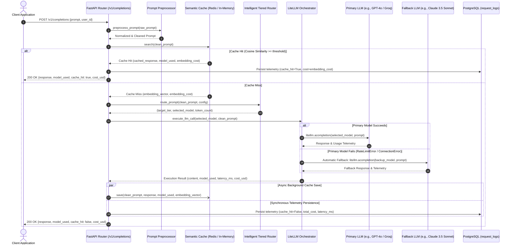

# System Architecture: Cost-Optimized LLM Gateway

This document provides a comprehensive technical overview of the **Cost-Optimized LLM Gateway**, detailing the request data flow, intelligent tiered routing heuristics, RediSearch vector-based semantic caching strategy, and telemetry logging architecture.

---

## 1. End-to-End System Data Flow

The following Mermaid sequence diagram illustrates the lifecycle of a prompt submitted to `POST /v1/completions`:



---

## 2. Intelligent Tiered Routing Heuristics

### 2.1 The Routing Problem
Directing 100% of enterprise prompts to a premier frontier model (e.g., GPT-4o at \$5.00/\$15.00 per million tokens) introduces immense and unnecessary operational expense. Simple classifications, sentiment evaluations, factual Q&A, and data formatting tasks do not require advanced frontier reasoning and can be fulfilled by high-throughput, low-cost models (e.g., Groq Llama 3 8B at \$0.05/\$0.08 per million tokens) — representing a **100x cost reduction**.

### 2.2 Model Tiers
| Tier | Default Configured Model | Primary Use Case | Relative Cost |
| :--- | :--- | :--- | :--- |
| **High Tier** | `gpt-4o` | Deep reasoning, multi-step synthesis, architectural evaluation, mathematical proofs, code generation. | 100x |
| **Mid Tier** | `claude-3-5-sonnet-20240620` | Extended document analysis, long-form reviews, complex summarization exceeding token thresholds. | 60x |
| **Low Tier** | `groq/llama3-8b-8192` | Quick fact extraction, greeting, formatting, short translations, simple Q&A. | 1x |

### 2.3 Evaluation Heuristics & Rules
Routing rules are loaded dynamically from `config.yaml` and evaluated in strict priority order (**First-Match-Wins**):

1. **Rule 1: High-Complexity Keywords (`contains_keyword`)**
   - **Keywords**: `["synthesize", "analyze", "critique", "evaluate", "prove", "reason", "architect"]`
   - **Rationale**: When users explicitly prompt the model to "synthesize", "analyze", or "critique", the task requires multi-perspective reasoning and nuance that smaller models frequently hallucinate or oversimplify.
   - **Target**: `high_tier` (`gpt-4o`).

2. **Rule 2: Long Context Threshold (`max_tokens_exceeded`)**
   - **Threshold**: `1000` tokens (counted via `tiktoken` with `cl100k_base` encoding).
   - **Rationale**: Prompts exceeding 1,000 tokens typically consist of full documentation sections, multi-page logs, or detailed code snippets. Mid-tier models such as Claude 3.5 Sonnet excel at large-context recall and structured parsing at roughly half the cost of flagship high-tier models.
   - **Target**: `mid_tier` (`claude-3-5-sonnet-20240620`).

3. **Rule 3: Catch-All Default (`catch_all`)**
   - **Rationale**: Standard short queries and everyday prompts without high-complexity keywords are routed to the most cost-effective tier.
   - **Target**: `low_tier` (`groq/llama3-8b-8192`).

---

## 3. Vector-Based Semantic Caching Strategy

### 3.1 Limitations of Exact-Match Caching
Traditional HTTP or string-based key-value caches (e.g., MD5 hashing of the prompt string) fail whenever phrasing differs slightly:
- Query A: *"How do I reset my account password?"*
- Query B: *"What is the process to reset my forgotten password?"*

Both queries ask for identical guidance, yet exact-string matching misses, invoking duplicate LLM calls and wasting capital.

### 3.2 Vector Embeddings & RediSearch
Semantic caching operates on vector embeddings:
1. When a prompt arrives, the preprocessor strips unprintable characters and reduces redundant newlines.
2. The gateway calls the embedding model (`text-embedding-3-small`, 1536 dimensions) via LiteLLM.
3. The resulting unit vector $\vec{v}_q \in \mathbb{R}^{1536}$ is searched against the vector index in Redis using K-Nearest Neighbor (KNN).

### 3.3 Cosine Similarity Mechanics
Cosine similarity measures the cosine of the angle between two vectors:

$$\text{Cosine Similarity}(\vec{u}, \vec{v}) = \frac{\vec{u} \cdot \vec{v}}{\|\vec{u}\|_2 \|\vec{v}\|_2}$$

In RediSearch, vector indexing with `DISTANCE_METRIC COSINE` measures **Cosine Distance** $D$:

$$D = 1 - \text{Cosine Similarity}(\vec{u}, \vec{v})$$

Therefore, the similarity score is computed as:

$$\text{Similarity} = 1.0 - D$$

- **Threshold Tuning**:
  - `similarity_threshold: 0.95`: Guarantees near-identical semantic intent. Only semantically equivalent prompts hit the cache, preventing incorrect responses.
  - On a Cache Hit ($\text{Similarity} \ge 0.95$), the cached answer is immediately returned to the client in `< 15ms`, bypassing the downstream LLM entirely.
  - On a Cache Miss, the new prompt vector, generated response, and metadata are written to Redis with a 24-hour TTL (`86400s`) asynchronously in a background task.

---

## 4. Automatic Fallbacks & Fault Tolerance

External LLM providers experience transient rate limits (`429 Too Many Requests`) and network outages (`503 Service Unavailable`, connection drops). 

The gateway incorporates automatic model failover:
- When LiteLLM raises `RateLimitError`, `APIConnectionError`, `Timeout`, or `ServiceUnavailableError`, the orchestrator catches the exception.
- It queries the `fallbacks` section in `config.yaml`:
  ```yaml
  fallbacks:
    - primary: "gpt-4o"
      backup: "claude-3-5-sonnet-20240620"
    - primary: "claude-3-5-sonnet-20240620"
      backup: "groq/llama3-8b-8192"
    - primary: "groq/llama3-8b-8192"
      backup: "gpt-4o"
  ```
- It seamlessly retries the prompt with the backup model, logs a warning for observability, and returns a successful `200 OK` with `model_used` reflecting the backup model.

---

## 5. Persistence and Telemetry

Every request is logged to a relational PostgreSQL database table `request_logs`:
- `id`: UUID (Primary Key)
- `timestamp`: UTC DateTime (Indexed)
- `user_id`: Client identifier for user-level attribution (Indexed)
- `model_used`: Actual model fulfilling the request
- `prompt_tokens`: Input tokens
- `completion_tokens`: Output tokens
- `total_tokens`: Total tokens
- `latency_ms`: Total execution time
- `cost_usd`: Granular transaction cost (including embedding cost)
- `cache_hit`: Boolean flag indicating whether the completion was served from Redis

The `/v1/analytics/summary` endpoint provides real-time aggregations (total cost, total requests, average latency, and cache hit rate percentage).
